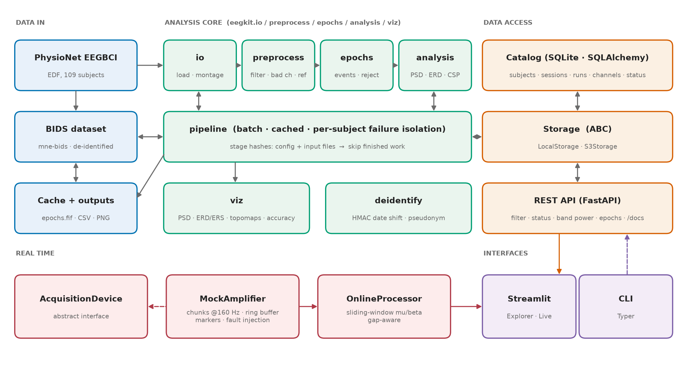
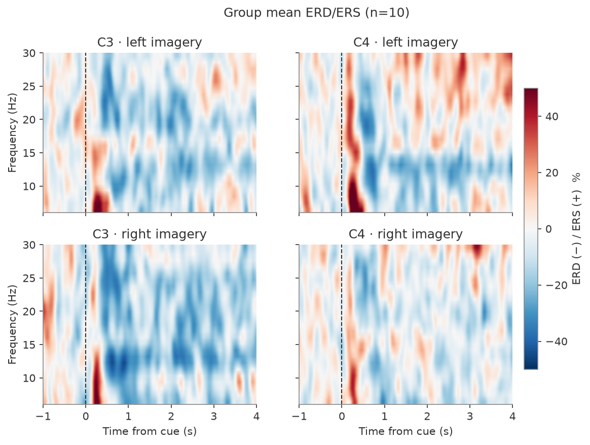
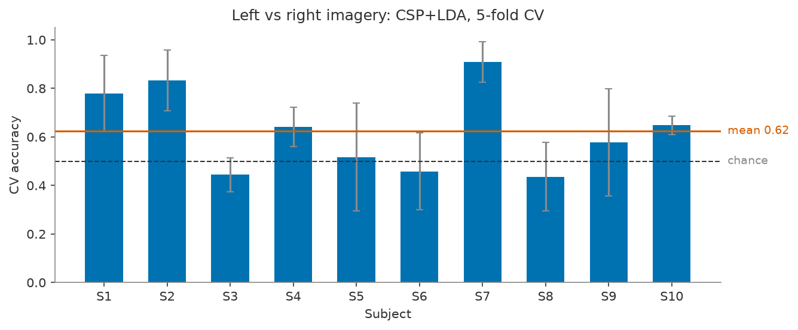
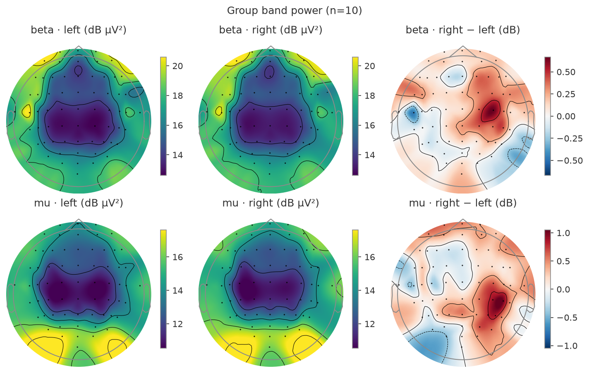
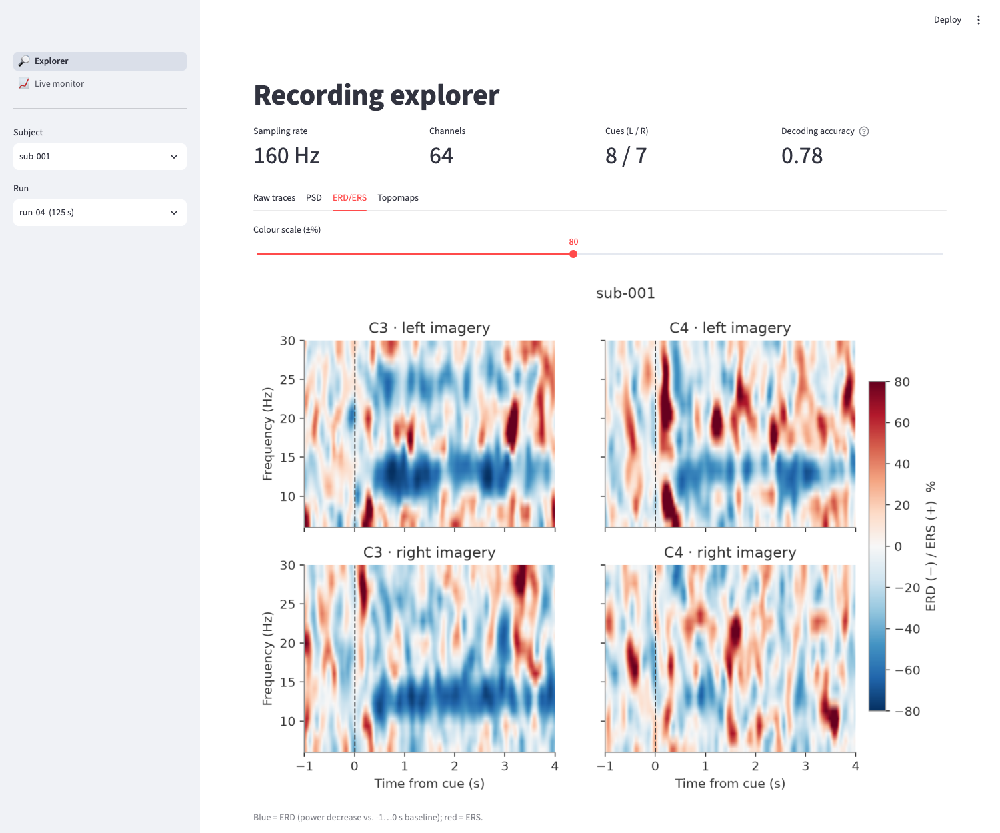
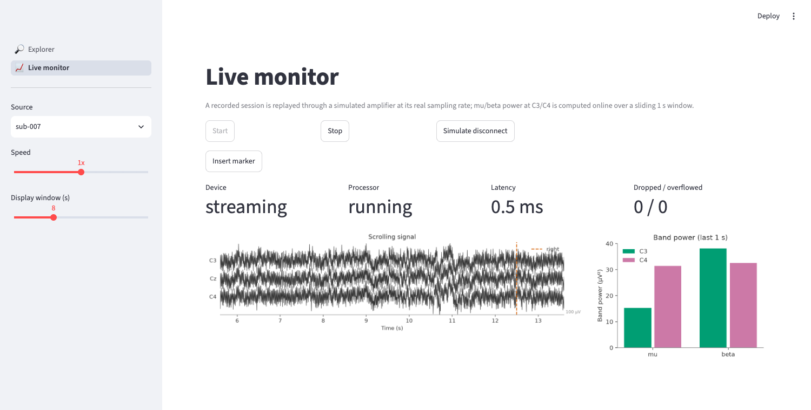

# eeg-toolkit

[](https://github.com/stone-coding/eeg-toolkit/actions/workflows/ci.yml)
[](https://github.com/stone-coding/eeg-toolkit/actions/workflows/docs.yml)
[](https://stone-coding.github.io/eeg-toolkit/)
[](pyproject.toml)
[](LICENSE)

A toolkit for **managing, accessing and analyzing human EEG data**, modeled on what a
neuroscience lab needs: reproducible batch analysis, a BIDS dataset, a queryable metadata
catalog behind a REST API, privacy-aware handling of recording metadata, a simulated real-time
acquisition path, and a GUI. Demonstrated on the PhysioNet **EEGBCI motor-imagery** dataset
(subjects 1-10, imagining left vs. right fist).

**Documentation: <https://stone-coding.github.io/eeg-toolkit/>**



| | |
|---|---|
| **Analysis** | filters, robust bad-channel detection, epoching + rejection report, band power, ERD/ERS, CSP+LDA decoding |
| **Data management** | BIDS via `mne-bids`, content-hash-cached batch pipeline, per-subject + group outputs, Typer CLI |
| **Data access** | SQLite catalog (SQLAlchemy), `Storage` ABC (local + S3-compatible), FastAPI with OpenAPI docs |
| **Privacy** | HMAC-keyed date shifting + pseudonyms, identifier scanner, tests proving nothing remains ([notes](docs/privacy.md)) |
| **Real time** | `AcquisitionDevice` ABC, `MockAmplifier`, ring buffer, online mu/beta power; drops, disconnects and overflow handled and tested |
| **GUI** | Streamlit Explorer + Live monitor |
| **Quality** | 119 tests on synthetic signals, 98 % coverage of the package (GUI smoke-tested), ruff, mypy, pre-commit, CI, Docker |

## Results (subjects 1-10)

**ERD/ERS** - group-mean percent power change vs. the pre-cue baseline. Imagery suppresses
mu/beta power (blue) over the contralateral motor cortex: right-hand imagery -> C3 (left
hemisphere) mu −17.6 % vs. −6.6 % at C4. The red burst right after the cue is the evoked
response, not synchronization.



**Decoding** - CSP+LDA, 5-fold stratified CV, ~45 trials per subject. Mean accuracy
**0.62 ± 0.17**: three subjects ≥ 0.7 (best 0.91), several at chance - typical for motor imagery
and for a data set this small.





<p>


</p>

## Quickstart

```bash
python -m venv .venv && source .venv/bin/activate
pip install -e ".[all]"

export EEGKIT_DEID_SALT="$(openssl rand -hex 16)"   # secret for date shifting
eegkit download                      # PhysioNet EEGBCI, subjects 1-10
eegkit to-bids                       # de-identified BIDS dataset in data/bids
eegkit run -c configs/default.yaml   # preprocess -> epochs -> analysis (cached), group summary
eegkit report --subject 2            # per-subject markdown report
eegkit index                         # metadata catalog
eegkit serve                         # API on :8000, docs at /docs
eegkit app                           # Streamlit GUI on :8501
```

```bash
docker compose up --build            # API :8000 and GUI :8501
pytest                               # synthetic signals only; --runslow adds real-data tests
```

## Layout

```
src/eegkit/  io preprocess epochs analysis/ viz   core analysis
             config logging bids pipeline cli     configuration, batch, CLI
             catalog storage api deidentify       data access + privacy
             realtime/                            device ABC, MockAmplifier, online power
             gui/                                 Streamlit pages
tests/  docs/  configs/  scripts/  Dockerfile  docker-compose.yml  mkdocs.yml
```

## Notes and limits

* Not a clinical tool. De-identification is a **demonstration, not a HIPAA certification**.
* The API has no authentication; the cache/outputs are local files.
* Rejection and decoding use a 15-channel sensorimotor ROI because this dataset is
  blink-heavy and unrefined by ICA; see the [configuration guide](docs/user-guide/configuration.md).
