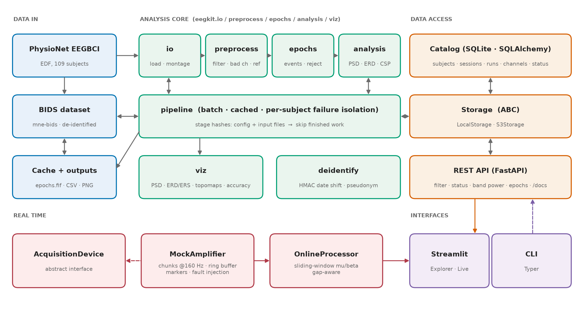
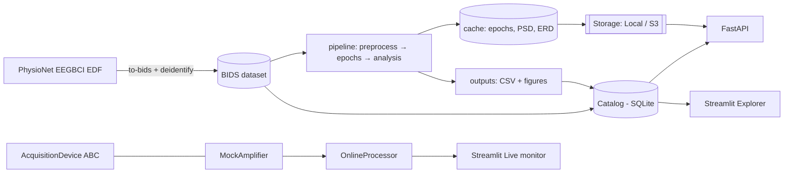

# Architecture

## Layers and dependencies

| Layer | Modules | Depends on |
|---|---|---|
| Core analysis | `io`, `preprocess`, `epochs`, `analysis`, `viz` | MNE, scikit-learn |
| Configuration / logging | `config`, `logging` | pydantic |
| Data management | `bids`, `pipeline`, `results`, `cli` | core |
| Data access | `catalog`, `storage`, `api`, `deidentify` | SQLAlchemy, FastAPI |
| Real time | `realtime.*` | numpy/scipy (+ core `analysis.spectral`) |
| GUI | `gui.*` | everything above |

Dependencies point one way: the core knows nothing about the catalog, API or GUI.

## Design decisions

* **BIDS is the system of record.** The catalog indexes BIDS; it can always be rebuilt.
* **De-identify at the ingest boundary**, so downstream components only see safe data.
* **Content-hash caching** per stage instead of timestamps: results are reproducible and
  stale outputs cannot survive a config change.
* **Storage addressed by key** so local disk and S3 are interchangeable.
* **Abstract device interface** so a real amplifier driver replaces `MockAmplifier` without
  touching consumers; a second `ScriptedDevice` in the tests proves it.
* **Gap-aware online processing** - correctness over continuity.
