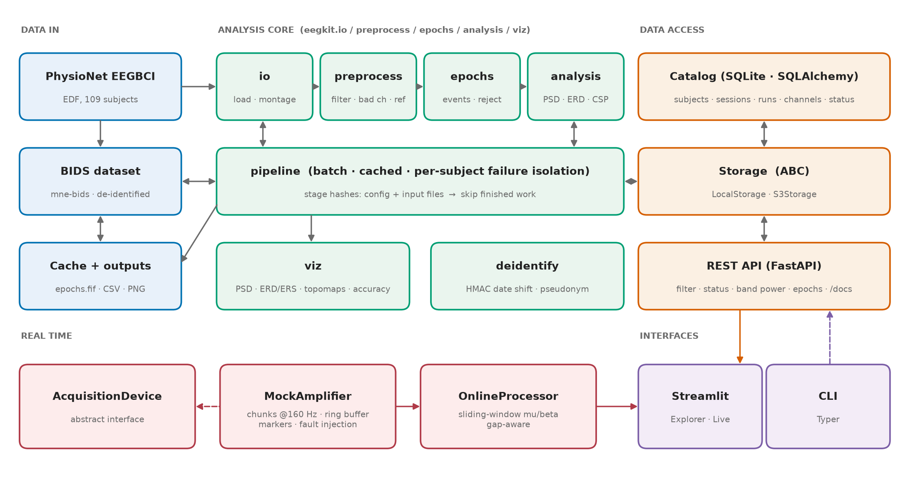
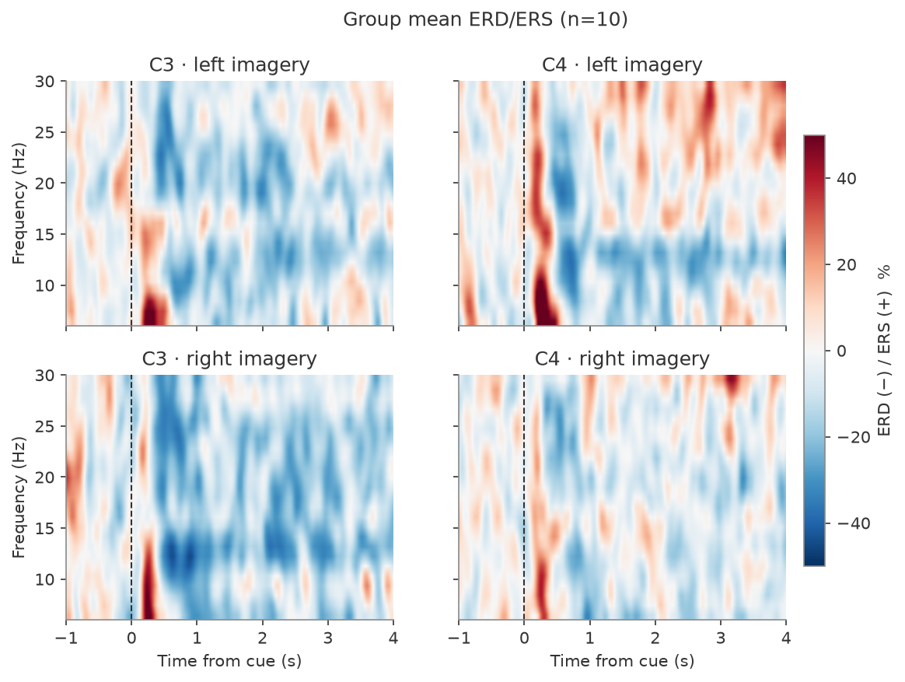
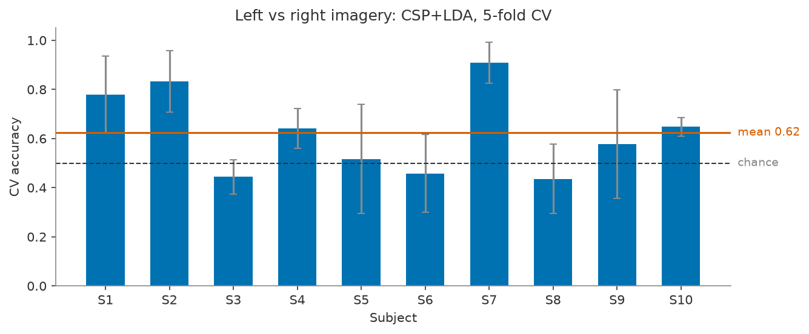
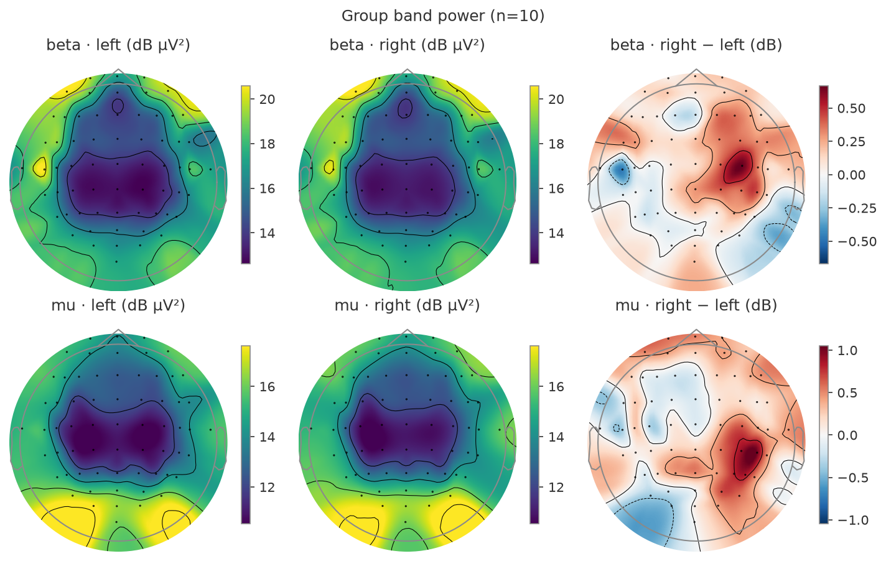

# eeg-toolkit

`eegkit` is a small, tested toolkit for **managing, accessing and analyzing human EEG data**,
built the way a neuroscience lab needs it: reproducible batch analysis, a BIDS dataset, a
queryable metadata catalog behind a REST API, privacy-aware metadata handling, and a
simulated real-time acquisition path - all demonstrated on the PhysioNet EEGBCI
motor-imagery dataset (subjects 1-10).

## What it does

| Area | Components |
|---|---|
| Analysis | filtering, bad channels, epoching + rejection, band power, ERD/ERS, CSP+LDA decoding |
| Data management | BIDS conversion (mne-bids), cached batch pipeline, group summary, CLI |
| Data access | SQLite catalog, local/S3 storage abstraction, FastAPI service |
| Privacy | keyed date shifting, identifier stripping, verifiable scan |
| Real time | device ABC, `MockAmplifier`, ring buffer, online mu/beta power, failure handling |
| GUI | Streamlit explorer and live monitor |

## Results on subjects 1-10

* **ERD/ERS** - imagining a hand movement suppresses mu (8-13 Hz) and beta power over the
  contralateral sensorimotor cortex (event-related desynchronization, blue). The red burst at
  6-10 Hz right after the cue is the evoked response, not a real synchronization.
* **Decoding** - left vs. right is classified from ~45 trials per subject with CSP+LDA; mean
  accuracy is about 62 %, with a wide spread: a few subjects exceed 80 %, others sit at chance.
  That is typical of motor-imagery BCI ("BCI illiteracy") and of this very small data set.

Start with [Getting started](getting-started.md).
