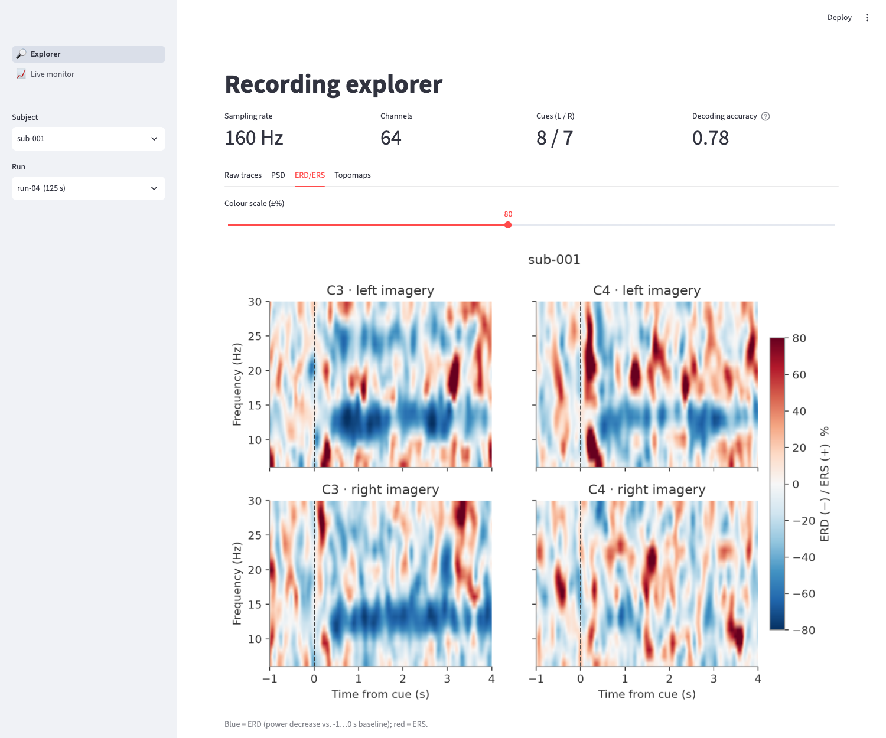
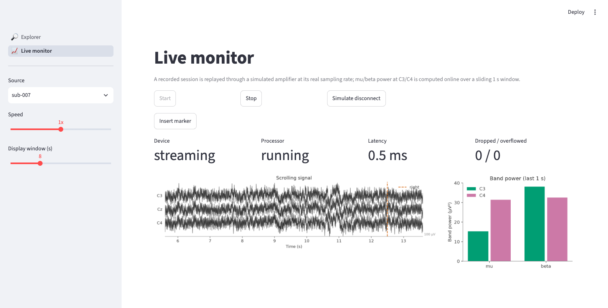

# GUI: `app`

```bash
eegkit app [-c config.yaml] [--port 8501] [--headless]
```

Needs a catalog (`eegkit index`) for the Explorer; the Live monitor also works with a built-in
synthetic signal.

## Explorer

Pick a subject and run from the catalog (sidebar). Tabs:

* **Raw traces** - scrollable window, channel selection, scale, cue markers;
* **PSD** - left vs. right spectra at chosen channels, mu/beta shaded;
* **ERD/ERS** - time-frequency maps at C3/C4, adjustable colour scale;
* **Topomaps** - mu/beta power per condition and the right-minus-left contrast.



## Live monitor

Start/stop a `MockAmplifier` replaying a subject (or synthetic data) at 0.5x/1x/2x. Shows the
scrolling C3/Cz/C4 signal with cue markers, band-power bars from the online processor, and
device/processor state, latency and dropped/overflowed chunk counters. **Simulate disconnect**
demonstrates the failure handling; **Insert marker** adds a user event.


